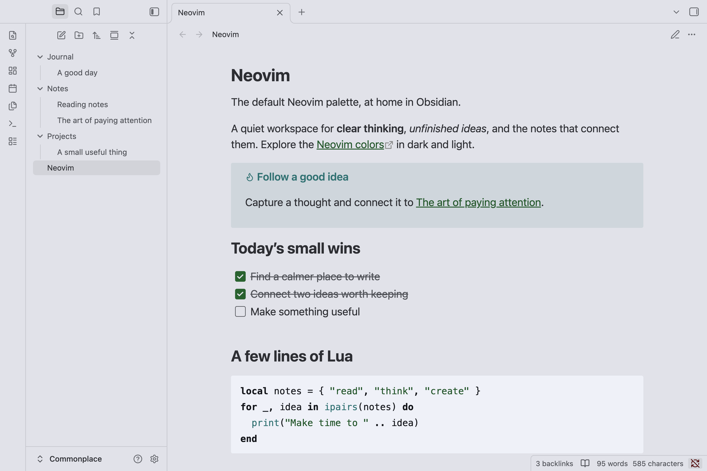

# Obsidian + Neovim

An Obsidian theme that keeps the default layout and uses the default Neovim
palette in dark and light modes. Neovim introduced this color scheme in
[version 0.10](https://neovim.io/roadmap/).

Check [this pull request](https://github.com/neovim/neovim/pull/26540) for more information.

## Installation

1. Open **Settings → Appearance** in Obsidian.
2. Under **Themes**, select **Manage**.
3. Search for **Neovim** and select it.
4. Select **Install and use** to apply the theme.

## Usage and customization

In **Settings → Appearance**, set **Base color scheme** to **Dark** or **Light**
to use the matching Neovim palette, or choose **Adapt to system** to follow your
system setting.

Body text uses softer shades for reading. Code follows Neovim's restrained
syntax colors, with green strings, cyan functions, and bold neutral keywords.
Quotes, callouts, highlights, and secondary labels use the same palette.
The Tasks plugin's filter and copy button also match the theme; the plugin
is optional.

Neovim does not provide any **Style Settings** options and does not require the
Style Settings plugin. For further customization, use Obsidian's
[CSS snippets](https://help.obsidian.md/snippets).

## Screenshots

### Dark

### Light

## Contributing

If you have any problems or have suggestions, welcome to issues.

---

## License

MIT License - see [LICENSE](LICENSE) for details.
