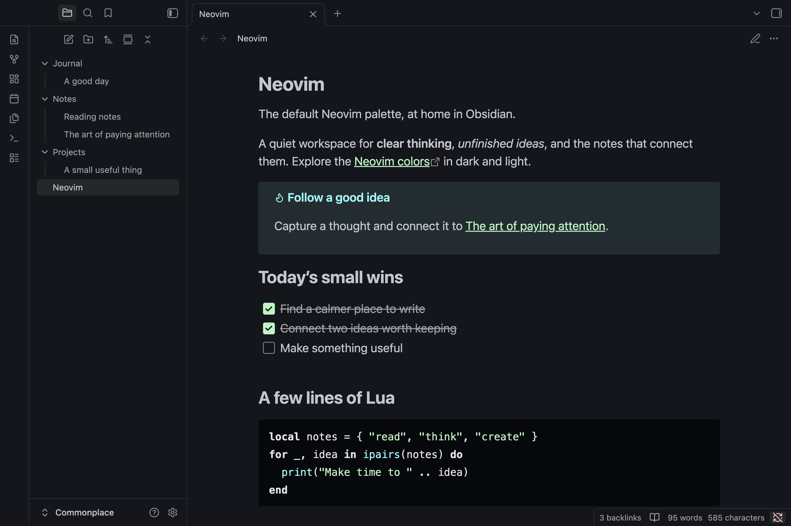

# Obsidian + Neovim

This is a basic Obsidian theme, only with modified colors to match the default Neovim color scheme, so nothing supernatural. The default Neovim color scheme is [announced](https://neovim.io/roadmap/) in version 0.10.

Check [this pull request](https://github.com/neovim/neovim/pull/26540) for more information.

## Installation

1. Open **Settings → Appearance** in Obsidian.
2. Under **Themes**, select **Manage**.
3. Search for **Neovim** and select it.
4. Select **Install and use** to apply the theme.

## Usage and customization

In **Settings → Appearance**, set **Base color scheme** to **Dark** or **Light**
to use the matching Neovim palette, or choose **Adapt to system** to follow your
system setting.

Neovim does not provide any **Style Settings** options and does not require the
Style Settings plugin. For further customization, use Obsidian's
[CSS snippets](https://help.obsidian.md/snippets).

## Screenshots

### Dark

### Light

## Contributing

If you have any problems or have suggestions, welcome to issues.

---

## License

MIT License - see [LICENSE](LICENSE) for details.
